<p align="center">
  
</p>

<p align="center">
  
  
  
  
  
  
  
  
</p>

---

## 📖 Overview

**Mowazze** is an advanced, production-grade Android hotspot and Wi-Fi repeater engine crafted with **Jetpack Compose (Material 3)** and **Kotlin Coroutines**.

Designed to overcome OEM restrictions (such as Samsung devices turning off Wi-Fi when activating a native hotspot), Mowazze operates seamlessly across **three distinct permission tiers: No-Root, Shizuku, and Root**. It provides unmatched flexibility, enterprise-grade traffic control, and an elite suite of root networking tools—including carrier TTL mangling, VPN hotspot sharing, network-wide AdBlock, and MAC address spoofing.

---

## ✨ Key Features

### 1. Three Permission Tiers (Adaptive Sharing Architecture)

* **No-Root (Wi-Fi Direct & Embedded Proxy Repeater):**
  * Repeats an existing Wi-Fi network over **Wi-Fi Direct (P2P Group)** without disconnecting your phone from Wi-Fi.
  * Embedded, non-blocking HTTP/HTTPS `CONNECT` proxy server running via **Kotlin Coroutines NIO** on port `8245`.
  * Built-in Proxy Auto-Configuration (PAC) file served at `http://192.168.49.1:8245/proxy.pac` for zero-friction client setup.
* **Shizuku (Privileged Native Tethering):**
  * Direct invocation of Android's private `TetheringManager` through **Shizuku API v23**, creating a true system-level hotspot without modifying `/system` or requiring root binaries.
  * Adaptive fallback engine automatically detects hardware capabilities and switches dynamically between native hotspot and Wi-Fi Direct.
* **Advanced Root Suite (Kernel & iptables Integration):**
  * **Carrier Tethering Bypass (TTL Mangling):** Fixes outgoing packet TTL to `64` (Android / Linux), `65` (Windows), or `128` on both IPv4 (`iptables`) and IPv6 (`ip6tables HL`) to disguise hotspot traffic as standard on-device usage.
  * **VPN Hotspot Sharing:** Forwards VPN traffic over the hotspot using `iptables -t nat -A POSTROUTING -o tun+ -j MASQUERADE` and IPv4 forwarding.
  * **Network-wide AdBlock:** Silently redirects all connected device DNS queries (UDP/TCP port 53) to AdGuard DNS (`94.140.14.14`), blocking advertisements without client configuration.
  * **Hardware MAC Address Changer & Spoofer:** Query, change, or randomize the `wlan0` MAC address using standard Linux socket calls, with one-tap restoration of the hardware original.
  * **Kernel-level Hardware Dropping:** Blocks unauthorized clients directly in the Linux kernel via `iptables -I FORWARD -m mac --mac-source <MAC> -j DROP`.

---

### 2. Device Management & Bandwidth Control

* **Real-time Client Discovery:** Live device monitoring displaying connected hardware type (Phone, Laptop, Tablet), IP address, and MAC address.
* **Per-device Bandwidth Throttling:** Throttle individual client speeds (1, 2, 5, 10 Mbps, or Unlimited).
* **Instant Client Blocking & Undo:** Immediate connection termination with an interactive Snackbar undo action.
* **Max Client Caps:** Restrict maximum simultaneous connections (1, 2, 3, 5, 8, 10, or Unlimited).
* **Daily Data Quota & 80% Alerts:**
  * Configurable daily data quota (1, 2, 5, 10 GB, or Unlimited) persisted in Jetpack DataStore.
  * High-visibility color-coded progress indicator in the usage overview.
  * Automatic threshold notification triggered when consumption reaches 80%.

---

### 3. Rapid Connect & Modern UX

* **Full-Screen High-Brightness QR Code:** Dedicated high-contrast QR dialog that temporarily raises screen brightness to maximum for instant camera scanning.
* **Proxy Configuration Card:** Clear visual instructions with one-tap copy buttons for proxy host, port, and PAC URL.
* **Bilingual & RTL-First:** Native Arabic RTL support with Latin digits and custom `IBM Plex Sans Arabic` typography, paired with a full English localization.
* **Large Screen & Tablet Dual-Pane:** Responsive layout utilizing `NavigationRail` and master-detail dual panes on screens wider than 840dp.
* **Expressive Material 3 Theming:** Full support for Dynamic Color, Light and Dark themes, and WCAG AA contrast compliance.

---

## 📊 Capabilities Matrix

| Feature / Capability | No-Root Mode | Shizuku Mode | Root Mode |
|---|:---:|:---:|:---:|
| **Share Active Wi-Fi (Repeater)** | ✔ (Wi-Fi Direct) | ✔ (If hardware allows) | ✔ (Full Stack) |
| **System Hotspot Broadcast** | ❌ (Manual setup) | ✔ (Automatic) | ✔ (Automatic) |
| **Connected Client Detection** | ✔ (ARP & P2P) | ✔ (TetheringManager) | ✔ (Linux Kernel) |
| **Bandwidth & Speed Limiting** | ❌ (Requires Shizuku/Root) | ✔ (Traffic Shaping) | ✔ (Traffic Shaping) |
| **Device Blocking** | ❌ (Upgrade Sheet) | ✔ (Blocklist) | ✔ (Kernel MAC Drop) |
| **Carrier TTL Bypass** | ❌ | ❌ | ✔ (iptables & ip6tables) |
| **Share Active VPN** | ❌ | ❌ | ✔ (iptables NAT Masquerade) |
| **Network-wide AdBlock** | ❌ | ❌ | ✔ (DNS Redirection) |
| **MAC Address Changer** | ❌ | ❌ | ✔ (ip link dev wlan0) |

---

## 🏗️ Architecture & Project Structure

The project follows Clean Architecture principles with unidirectional data flow (MVI/Flow):

```text
com.mowazze3
├── data/
│   ├── proxy/               # Embedded NIO coroutine proxy server (MowazzeProxyServer)
│   ├── root/                # Root network manager for iptables, NAT & MAC spoofing (RootNetworkManager)
│   ├── AdaptiveShareEngine  # Smart engine toggling between Shizuku and Wi-Fi Direct
│   ├── WifiDirectShareEngine# Wi-Fi Direct P2P Group repeater engine
│   ├── ShizukuShareEngine   # System tethering engine powered by Shizuku API
│   ├── DataStoreSettings    # Jetpack DataStore persistence implementation
│   └── ShareRepository      # Single Source of Truth for sharing state & stats
├── domain/                  # Pure Kotlin models, usage calculations, and contracts
├── service/                 # Foreground ShareService for background lifecycle management
└── ui/
    ├── home/                # Home screen, QR dialog, and proxy connection guide
    ├── devices/             # Client list, usage stats, speed limits, and blocking
    ├── settings/            # Settings, data quotas, and Root Tools bottom sheet (RootToolsSheet)
    ├── onboarding/          # First-run wizard, device probing, and Shizuku linking
    └── theme/               # Material 3 color schemes, typography, shapes, and tokens
```

---

## 🛠️ Building & Development

### Prerequisites
* **Android Studio:** Hedgehog (2023.1.1) or newer
* **JDK:** Java 17+ (Android Studio JBR recommended)
* **Android SDK:** Compile SDK 37, Min SDK 26 (Android 8.0 Oreo)

### Build Commands (PowerShell)
```powershell
# Set JAVA_HOME to Android Studio JBR
$env:JAVA_HOME = "C:\Program Files\Android\Android Studio\jbr"

# Run all unit tests
.\gradlew test

# Build debug APK
.\gradlew assembleDebug

# Build signed release APK
.\gradlew assembleRelease
```

### Installing via ADB
```powershell
adb install -r app\build\outputs\apk\release\app-release.apk
```

---

## 📦 Releases

Download pre-compiled and signed APK packages directly from the [GitHub Releases](https://github.com/mahmoudteirdev/mowazze/releases) page.

* **Latest Release:** `v1.0.0`
* **Package Name:** `com.mowazze3`
* **Signature Scheme:** APK Signature Scheme v2 (Signed & Verified)

---

## 📄 License

This project is licensed under the **Apache License, Version 2.0**.
Included fonts (`IBM Plex Sans Arabic`) are licensed under the **SIL Open Font License (OFL 1.1)**.
See the [LICENSE](LICENSE) file for more information.

---

<p align="center">
  Engineered with precision for open, unrestricted Android internet sharing 🌐
</p>
